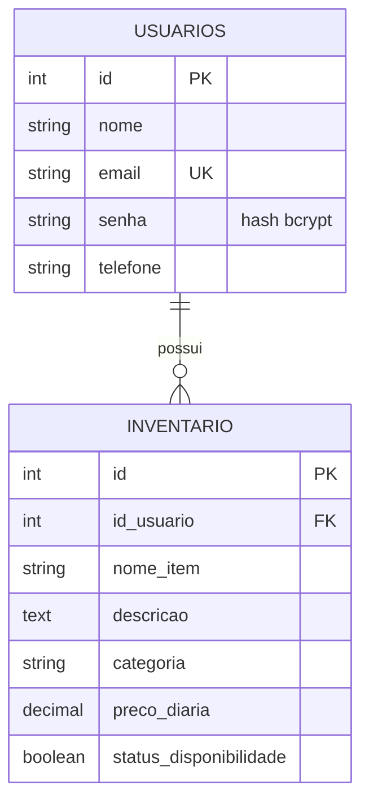

# Caixa de Ferramentas

Sistema web para organizar o inventário de ferramentas de cada usuário: cadastro de conta, login e controle dos itens (nome, descrição, categoria, valor da diária e disponibilidade).

Projeto da Unidade III de Desenvolvimento de Sistemas (IFSC), com **front-end em React** e **API REST em Node.js + Express**, autenticação com **JWT** e banco de dados relacional **PostgreSQL**.

## Problema que o sistema resolve

Quem tem ferramentas em casa ou na oficina costuma perder o controle do que possui, de quanto vale a diária de cada item e do que está disponível. A Caixa de Ferramentas guarda tudo em um só lugar: o usuário cadastra cada ferramenta, escolhe a categoria, define o valor da diária e marca se o item está disponível. Cada usuário enxerga e altera apenas as próprias ferramentas.

## Decisões de modelagem

- **Duas tabelas, relação de um para muitos:** um usuário tem muitos itens de inventário; cada item pertence a um único usuário (`inventario.id_usuario`).
- **E-mail único** em `usuarios`, para que não existam duas contas com o mesmo e-mail.
- **Senha guardada como hash (bcrypt)**, nunca em texto puro, e nunca devolvida pela API.
- **Exclusão em cascata:** se um usuário é excluído, os itens dele também são.
- **Categoria com lista fixa** (Elétrica, Manual, Jardinagem, Construção, Outros), validada no servidor e usada na tela de cadastro.
- **Valor da diária** como número decimal e **disponibilidade** como verdadeiro/falso.
- **Isolamento por usuário:** toda consulta ao inventário filtra pelo id do usuário que vem do token JWT, e não por um dado enviado pelo front-end.

### Diagrama das tabelas



**usuarios**

| Campo | Tipo | Observação |
|-------|------|-----------|
| id | inteiro | chave primária |
| nome | texto (100) | obrigatório |
| email | texto (100) | obrigatório e único |
| senha | texto (255) | hash bcrypt |
| telefone | texto (20) | opcional |

**inventario**

| Campo | Tipo | Observação |
|-------|------|-----------|
| id | inteiro | chave primária |
| id_usuario | inteiro | chave estrangeira para `usuarios` |
| nome_item | texto (150) | obrigatório |
| descricao | texto | opcional |
| categoria | texto (50) | Elétrica, Manual, Jardinagem, Construção ou Outros |
| preco_diaria | decimal (10,2) | obrigatório |
| status_disponibilidade | verdadeiro/falso | disponível ou indisponível |

As tabelas também têm as colunas `created_at` e `updated_at` (data de criação e de alteração).

### Script SQL

O servidor cria as tabelas sozinho ao iniciar (Sequelize `sync`). Para criar manualmente, use os scripts da pasta `backend/database`:

- `schema.postgres.sql` (PostgreSQL / Supabase: menu **SQL Editor**, colar o script e clicar em **Run**)
- `schema.mysql.sql` (MySQL, para uso local)

## Endereços publicados

| Parte | Serviço | Endereço |
|-------|---------|----------|
| Site (front-end) | Vercel | https://projeto-integrador-two-amber.vercel.app |
| API (back-end) | Render | https://projeto-integrador-puvz.onrender.com |
| Banco de dados | Supabase (PostgreSQL) | acesso privado |

Teste rápido da API: https://projeto-integrador-puvz.onrender.com/api/status

> A API fica no plano gratuito do Render e "dorme" quando fica parada. A primeira resposta pode levar cerca de 50 segundos.

## Tecnologias

- **Front-end:** React, Vite, React Router, Axios
- **Back-end:** Node.js, Express, Sequelize
- **Banco de dados:** PostgreSQL (Supabase)
- **Autenticação:** JWT (validade de 1 hora) e senhas com bcrypt

## Estrutura do projeto

```
Projeto-Integrador/
├── backend/    API REST (rotas, controladores, modelos, middleware e configuração)
└── frontend/   Site em React (páginas, componentes, contexto de login e serviços)
```

## Rotas da API

Todas começam com `/api`. O corpo das requisições e das respostas é JSON.

**Públicas**

| Método | Rota | Função |
|--------|------|--------|
| GET | `/status` | verifica se a API está no ar |
| POST | `/auth/register` | cria uma conta (guarda apenas o hash da senha) |
| POST | `/auth/login` | valida o login e devolve o token JWT |

**Protegidas** (exigem o cabeçalho `Authorization: Bearer <token>`)

| Método | Rota | Função |
|--------|------|--------|
| GET | `/auth/me` | dados do usuário logado |
| GET | `/inventario` | lista apenas os itens do usuário logado |
| GET | `/inventario/categorias` | lista as categorias aceitas |
| GET | `/inventario/:id` | detalhes de um item do usuário |
| POST | `/inventario` | cadastra um item vinculado ao usuário do token |
| PUT | `/inventario/:id` | edita um item do usuário |
| DELETE | `/inventario/:id` | exclui um item do usuário |

**Códigos HTTP usados:** 200 (sucesso), 201 (criado), 400 (dados inválidos), 401 (token ausente, inválido ou expirado, ou login incorreto), 404 (item inexistente ou de outro usuário), 409 (e-mail já cadastrado) e 500 (erro interno, sem expor segredos).

## Como rodar no seu computador

Pré-requisitos: Node.js instalado e um banco PostgreSQL (pode ser um projeto gratuito no Supabase) ou MySQL.

### 1. Back-end

```bash
cd backend
npm install
```

Crie o arquivo `backend/.env` a partir do modelo `backend/.env.example` e preencha os valores:

```bash
cp .env.example .env
```

| Variável | Para que serve |
|----------|----------------|
| `PORT` | porta da API (padrão 3000) |
| `JWT_SECRET` | chave que assina os tokens (mínimo 32 caracteres) |
| `DATABASE_URL` | endereço de conexão com o banco (PostgreSQL / Supabase) |
| `DB_SSL` | `true` liga a conexão segura, exigida por bancos hospedados |
| `CORS_ORIGIN` | endereço(s) do front que podem chamar a API, separados por vírgula |
| `DB_DIALECT`, `DB_HOST`, `DB_PORT`, `DB_NAME`, `DB_USER`, `DB_PASS` | alternativa à `DATABASE_URL`, para um banco local |

Para gerar uma chave segura para o `JWT_SECRET`:

```bash
node -e "console.log(require('crypto').randomBytes(48).toString('hex'))"
```

Inicie a API (as tabelas são criadas automaticamente):

```bash
npm start
```

Opcional: criar um usuário e itens de demonstração.

```bash
npm run seed
```

### 2. Front-end

Em outro terminal:

```bash
cd frontend
npm install
npm run dev
```

Abra o endereço mostrado no terminal (normalmente http://localhost:5173). Em desenvolvimento, o Vite encaminha as chamadas de `/api` para a API em `localhost:3000`. A variável `VITE_API_URL` (modelo em `frontend/.env.example`) define o endereço da API.

## Como foi publicado

**Banco (Supabase):** projeto PostgreSQL gratuito. A API usa a *Connection string* do **Session pooler**.

**API (Render):** serviço Web com *Root Directory* `backend`, *Build Command* `npm install` e *Start Command* `npm start`. Variáveis de ambiente: `DATABASE_URL`, `JWT_SECRET` e `CORS_ORIGIN` (com o endereço do site na Vercel).

**Front (Vercel):** projeto com *Root Directory* `frontend` e a variável `VITE_API_URL` apontando para `https://projeto-integrador-puvz.onrender.com/api`.

## Segurança

- Senhas guardadas com bcrypt, nunca em texto puro nem devolvidas nas respostas.
- Rotas do inventário protegidas por token JWT com validade; token ausente, inválido ou expirado é recusado.
- Cada usuário só acessa os próprios itens.
- Segredos (`JWT_SECRET`, senha do banco) ficam em variáveis de ambiente e não vão para o GitHub (o arquivo `.env` é ignorado; o repositório traz apenas o `.env.example`).
- CORS liberado apenas para o endereço do front-end.
- Proteção por linha (RLS) ativada nas tabelas do Supabase.

## Autor

André Luis Miranda